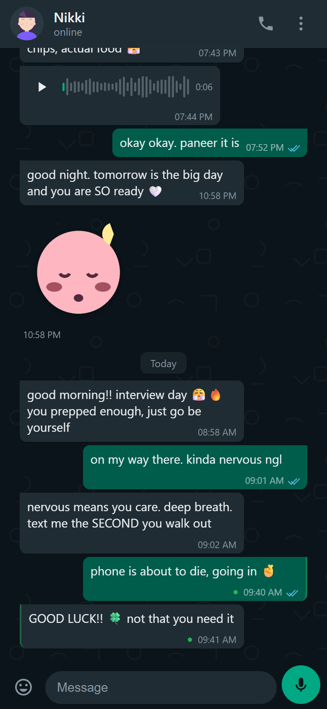
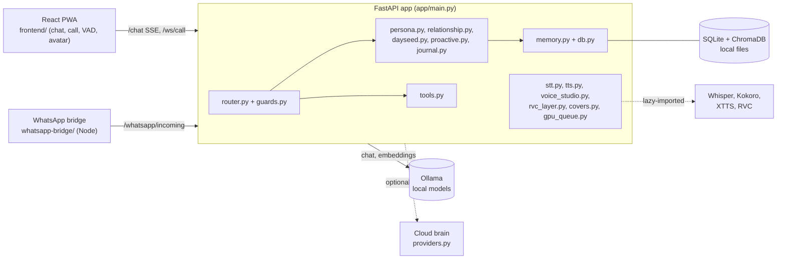

# Nikki: a local AI companion

[](https://github.com/Naresh23032003/Nikki-AI-Companion/actions/workflows/ci.yml)


**A self-hosted AI companion that texts, remembers your life across sessions and runs on your own machine, with a local Ollama model, one FastAPI server and a phone-installable React app.**

<!-- TODO(demo): record docs/demo.gif (about 800 px wide, 10 MB or less) with the script from task nikki-004, then replace the block below with:  -->
<p align="center">
  <a href="docs/demo.mp4">
    
  </a>
  <br>
  <a href="docs/demo.mp4">Watch the demo video</a>
</p>

## Why it exists
Most companion apps send every message to someone else's server. This one keeps chat history, memories, voice and persona in local SQLite and ChromaDB files. One optional cloud model can be switched off, and every payload it receives is logged.

## Features
Each item below maps to a module in `app/`.
- **WhatsApp-style chat.** Streaming replies over SSE (`POST /chat`), a React PWA you install from your own WiFi.
- **Long-term memory** (`app/memory.py`, `app/db.py`). A background pass extracts facts as JSON, embeds them with `nomic-embed-text`, stores them in SQLite and ChromaDB, and merges near-duplicates. List, add and delete through `/memories`.
- **Relationship stages** (`app/relationship.py`). stranger, acquaintance, friend, close, girlfriend. Promotion needs affection, days known and stored memories together (`THRESHOLDS` in that file).
- **Daily life and proactive messages** (`app/dayseed.py`, `app/proactive.py`). A per-day state shapes replies, and she messages first within per-persona limits (APScheduler).
- **Router, guards and optional cloud brain** (`app/router.py`, `app/guards.py`, `app/providers.py`). Deterministic routing rules, tone and false-claim guards, and an audit log for cloud payloads (`cloud_audit.jsonl`). Master switch: `brain.cloud_enabled: false` in `config.yaml`.
- **Local tools** (`app/tools.py`): reminders, weather, todos, expenses, events.
- **Mood journal** (`app/journal.py`). A nightly local pass, a weekly pattern pass.
- **Voice, calls and covers (full install only).** faster-whisper speech input (`app/stt.py`), Kokoro voice notes (`app/tts.py`), call mode over `WS /ws/call` with browser VAD and barge-in, optional XTTS and RVC voices (`app/voice_studio.py`, `app/rvc_layer.py`), singing covers (`app/covers.py`).
- **WhatsApp bridge** (`whatsapp-bridge/`, Node). Unofficial client, use a disposable second number. See [whatsapp-bridge/README.md](whatsapp-bridge/README.md).
- **Personas** in `personas/*.yaml`, plus isolated profiles per WhatsApp number (`app/profiles.py`).

## Architecture


## Tech stack
Python 3.12, FastAPI, uvicorn, httpx, pydantic, APScheduler, SQLite, ChromaDB; React 18 and Vite 5 (PWA); Ollama; optional faster-whisper, Kokoro, Demucs, XTTS-v2, RVC; whatsapp-web.js.

## Quick start

### Lite: Docker, text chat and memory, CPU only
```bash
git clone https://github.com/Naresh23032003/Nikki-AI-Companion.git
cd Nikki-AI-Companion
docker compose up --build
```
Open http://localhost:8000. The first start downloads the models (about 2 GB per the compose file comment) into a named volume. Voice, calls and WhatsApp are not in the lite image; those endpoints report "voice unavailable".

### Full: local install
Prerequisites: Python 3.12 (the version CI uses), Node.js 20 (the version CI uses), [Ollama](https://ollama.com) running.

```bash
ollama pull huihui_ai/llama3.2-abliterate:3b   # chat and extraction model set in config.yaml
ollama pull nomic-embed-text                    # memory embeddings
ollama pull moondream                           # optional: photo captions
# To use stock llama3.2:3b instead, pull it and change ollama.model and ollama.extract_model in config.yaml.

python -m venv .venv
source .venv/bin/activate                       # Windows: .venv\Scripts\Activate.ps1
pip install -r requirements.txt                 # core: chat + memory
pip install -r requirements-voice.txt           # optional: voice notes, mic, call mode (needs espeak-ng)

npm --prefix frontend install
npm --prefix frontend run build

cp .env.example .env                            # optional keys; Windows: copy .env.example .env
uvicorn app.main:app --host 0.0.0.0 --port 8000
```
Open http://localhost:8000 and check `curl http://localhost:8000/health`.

Phone install: open `http://<your-LAN-IP>:8000` on the same WiFi and use "Add to Home screen". Browsers may block the mic on a plain-HTTP LAN address; use localhost or HTTPS.

## Configuration
Behaviour lives in [config.yaml](config.yaml) (sections: `ollama`, `persona`, `profiles`, `memory`, `stt`, `tts`, `voice`, `brain`, `router`, `behavior`, `journal`, `whatsapp`). Secrets go in `.env`; names only:

| Variable | Used for |
|---|---|
| `GROQ_API_KEY`, `GEMINI_API_KEY`, `CEREBRAS_API_KEY` | Optional cloud brain providers |
| `COMPANION_AUTH_TOKEN` | Token required from non-localhost clients |
| `COQUI_TOS_AGREED` | Accepts the XTTS license prompt (personal use) |
| `OLLAMA_BASE_URL`, `OLLAMA_MODEL`, `OLLAMA_EMBED_MODEL` | Override `config.yaml` (used by Docker) |
| `COMPANION_DB_PATH`, `CHROMA_PATH` | Move the database and vector store |

## Tests
```bash
pip install -r requirements.txt ruff
ruff check app tests
python tests/run_evals.py          # deterministic: routing, guards, temporal memory, journal
python tests/run_evals.py --llm    # also the Ollama-backed evals (needs local models)
```
CI (`.github/workflows/ci.yml`) runs lint, a lite-boot import check, the deterministic evals, the frontend build and the Docker lite image build.
<!-- TODO(demo): paste the real summary table from `python tests/run_evals.py`. The previous README listed routing 64/64, tone guards 10/10, temporal memory 9/9, journal patterns 8/8; re-run before publishing these numbers. -->
<!-- TODO(demo): measured latencies (memory retrieval, RVC per chunk, studio voice note) from the previous README need a fresh logged run on the author's RTX 3060 before they are quoted. -->

## Project structure
```
app/                FastAPI backend (main.py, router, guards, memory, relationship, proactive, journal, voice modules)
frontend/           React + Vite PWA (chat, call mode, settings)
whatsapp-bridge/    Node bridge using whatsapp-web.js
personas/           Persona YAML files
tests/              Eval and unit suites, run_evals.py runner
tools/              Voice dataset and RVC training helpers
docs/               Screenshot, demo video, RVC training notes
docker/             Container entrypoint
config.yaml         All non-secret settings
```

## API
| Method | Path | Purpose |
|---|---|---|
| POST | `/chat` | Stream a reply (SSE) |
| GET, DELETE | `/history/{session_id}` | Fetch or clear history |
| GET, POST, DELETE | `/memories` | List, add, delete memories |
| GET, POST | `/personas`, `/personas/active` | List or switch personas |
| POST | `/stt`, `/tts` | Speech to text, text to speech |
| WS | `/ws/call` | Call mode |
| POST | `/whatsapp/incoming` | Bridge entry point |
| GET | `/proactive/status`, `/brain/status`, `/health` | Status endpoints |

## Roadmap
- Fix the Docker lite extraction-model default (task nikki-001).
- Unit tests for the relationship tracker (nikki-002).
- Reproducible demo with a fake Ollama server (nikki-003, nikki-004).
- <!-- TODO: maintainer to add 1 to 2 real roadmap items. -->

## Privacy and ethics
- Local-first: history, memories and persona stay in local files. The cloud brain is optional and audited.
- Voice cloning needs the voice owner's informed consent and is for personal use. `python cleanup_voice.py` deletes everything derived from a voice.
- No personal data ships in the repo; databases, voice data and WhatsApp sessions are gitignored.
- WhatsApp access uses an unofficial client and can get an account banned.

## License
MIT, see [LICENSE](LICENSE).
